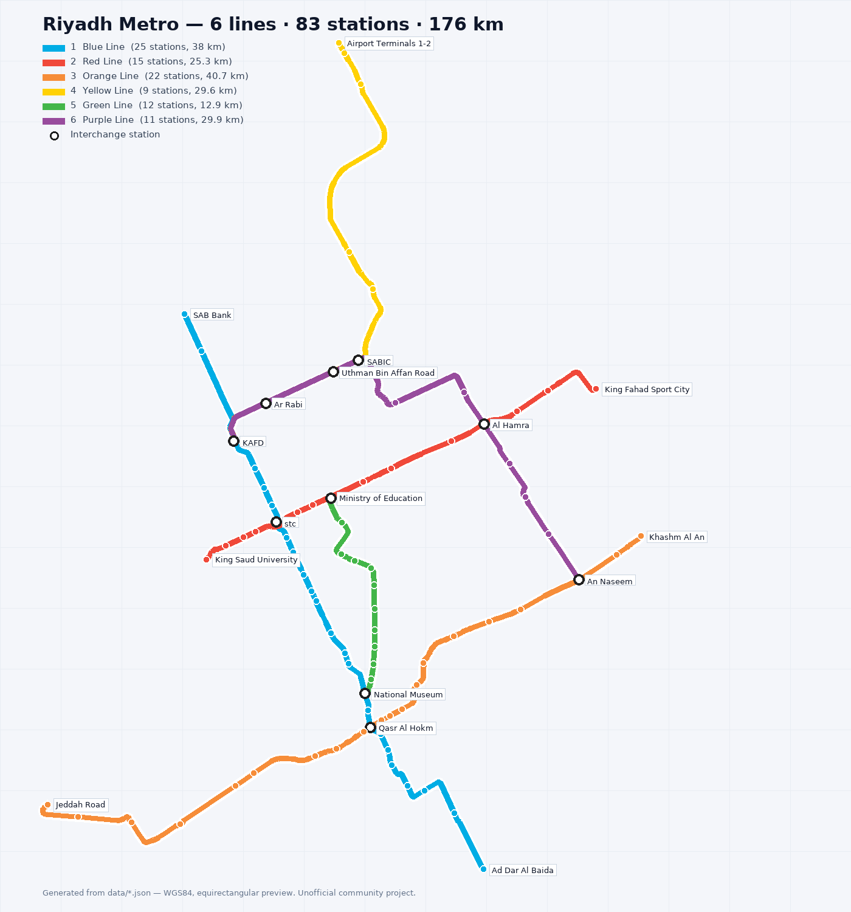
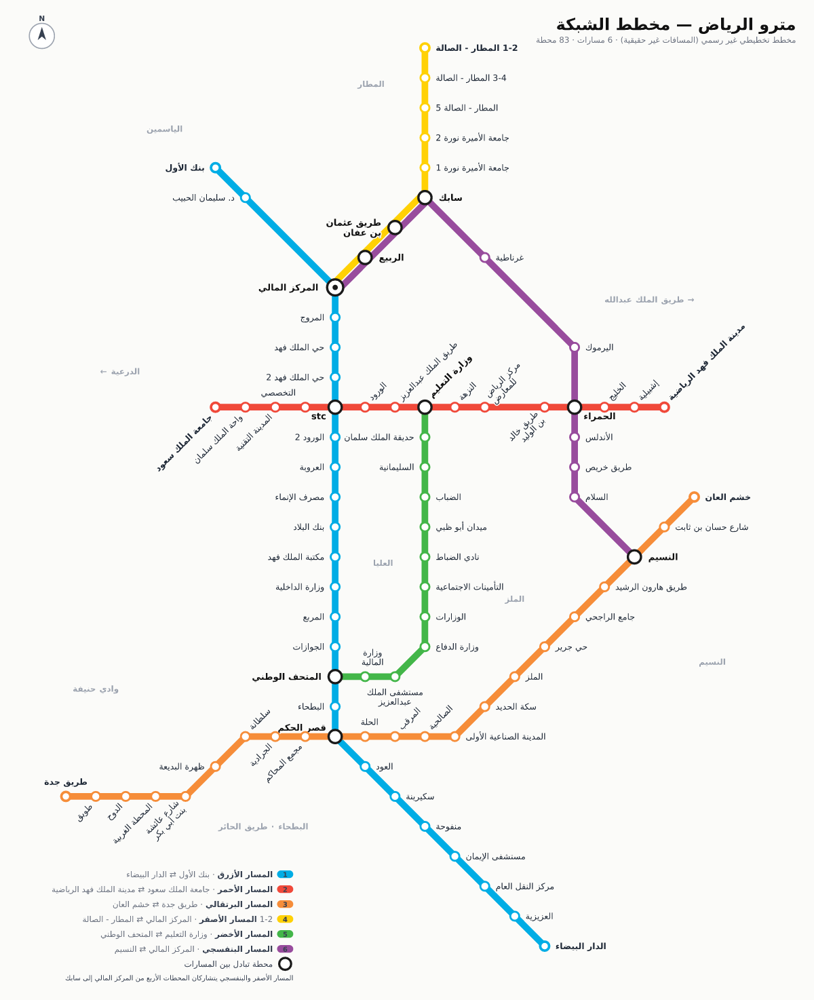
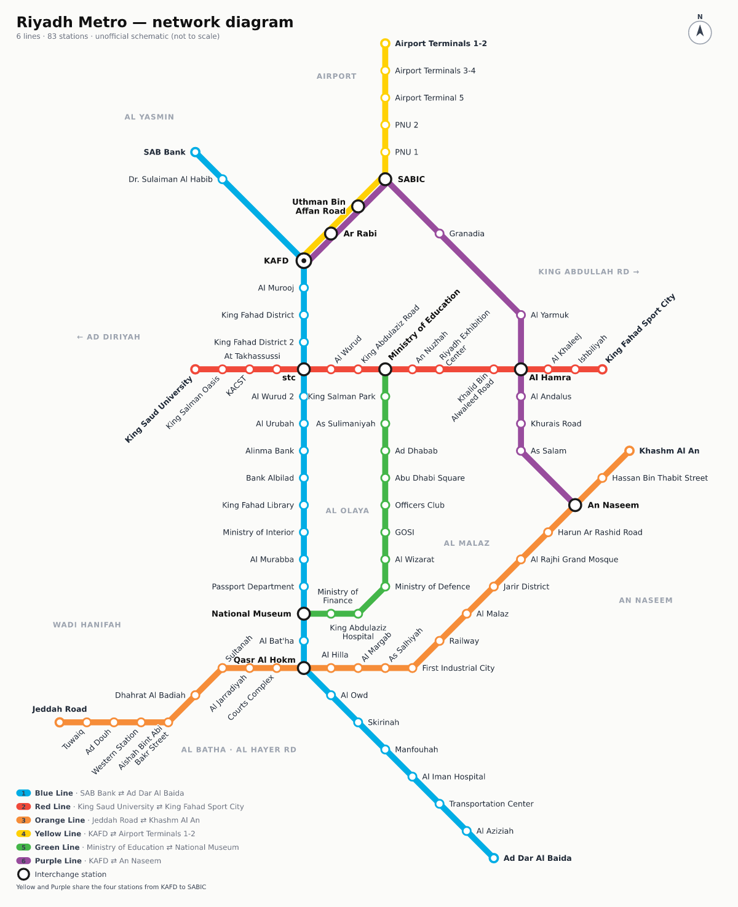

<div dir="rtl">

# 🚇 مترو الرياض — دليل التنقل | Riyadh Metro Navigator

**إسقاط كامل لشبكة مترو الرياض (6 مسارات، 83 محطة، 176 كم) على Google Earth وخرائط Google، مع مخطط شبكة تفاعلي ومخطط رحلات للتنقل بين أي محطتين أو مكانين — بالأوقات والأسعار وبثماني لغات.**

[](https://github.com/engmohammeda/RiyadhMetro-/actions/workflows/ci.yml)






## ⚡ ابدأ خلال دقيقة

| أريد… | افعل هذا |
|---|---|
| 🌍 **الشبكة كاملة داخل Google Earth** | حمّل [`dist/riyadh-metro.kmz`](dist/riyadh-metro.kmz) وافتحه (سطح المكتب: File → Open · الويب: المشاريع → استيراد KML · الجوال: افتح الملف بـ Google Earth). [التفاصيل](docs/google-earth.md) |
| 🗺️ **الشبكة داخل تطبيق خرائط Google** | استورد [`dist/riyadh-metro.kml`](dist/riyadh-metro.kml) في [Google My Maps](https://www.google.com/maps/d/) ← تظهر في التطبيق ضمن «المحفوظة → الخرائط». [التفاصيل](docs/google-maps.md) |
| 🧭 **تخطيط رحلة بين محطتين أو مكانين** | افتح التطبيق التفاعلي `web/` (محلياً: `npm start` ثم http://localhost:8080) أو انشره على GitHub Pages — انقر على محطتين في **المخطط**، أو اكتب محطة/مكاناً («العليا»، «برج المملكة»، «المطار») وستحصل على المسار، وقت المغادرة والوصول، التذكرة، التبديلات، ورابط قصير للمشاركة مثل `#al-batha~al-hamra~ar` |
| 🌐 **المسارات فوق Google Maps مباشرة** | افتح `web/google-maps.html?key=YOUR_KEY` — دمج احترافي كامل عبر Maps JavaScript API: مسارات بألوانها الرسمية فوق الخريطة، محطات تفاعلية، رحلة بأسهم اتجاه متحركة، وإبراز أي خط بنقرة. [التفاصيل](docs/google-maps.md) |
| 🚇 **مخطط الشبكة للطباعة** | [`dist/riyadh-metro-diagram.svg`](dist/riyadh-metro-diagram.svg) (عربي) · [`dist/riyadh-metro-diagram-en.svg`](dist/riyadh-metro-diagram-en.svg) (إنجليزي) |
| 🧩 **دمج البيانات في تطبيقي** | [`dist/riyadh-metro.geojson`](dist/riyadh-metro.geojson) · [`dist/riyadh-metro-network.json`](dist/riyadh-metro-network.json) · [`dist/riyadh-metro-stations.csv`](dist/riyadh-metro-stations.csv) · [`dist/riyadh-metro.gpx`](dist/riyadh-metro.gpx) |

## ✨ ما الذي يقدّمه المشروع؟

### 1. ملفات جاهزة لـ Google Earth / Google Maps (مجلد `dist/`)

| الملف | الاستخدام |
|---|---|
| `riyadh-metro.kmz` | حزمة Google Earth: المسارات الستة بألوانها الرسمية فوق المسار الهندسي الفعلي، 94 توقّفاً مرتباً داخل مجلد لكل مسار، مجلد **محطات التبادل** (10)، بالون معلومات ثنائي اللغة لكل محطة (المسارات، المحطة السابقة/التالية، النوع، الإحداثيات، روابط خرائط Google/Earth)، و**6 جولات طيران افتراضية** فوق كل مسار، بأيقونات مضمّنة |
| `riyadh-metro.kml` | نفس المحتوى بصيغة KML عادية (أيقونات مستضافة) — للاستيراد في Google My Maps |
| `lines/line-1-blue.kml` … `line-6-purple.kml` | كل مسار في ملف مستقل (طبقة لكل مسار في My Maps) |
| `riyadh-metro.geojson` (+ `-lines`, `-stations`, `-segments`) | GeoJSON بخصائص simplestyle — يُعرض ملوّناً مباشرة على GitHub وgeojson.io وQGIS وMapLibre وGoogle Maps Data Layer |
| `riyadh-metro-stations.csv` | جدول المحطات (عربي/إنجليزي، إحداثيات، مسارات، نوع، روابط Google) — My Maps / Excel / Sheets |
| `riyadh-metro-places.{geojson,csv}` | ~50 وجهة شهيرة (مولات، مستشفيات، جامعات، معالم…) مع **أقرب محطة ومسافة المشي** — تظهر أيضاً كمجلد «أماكن ووجهات» داخل KMZ |
| `riyadh-metro-diagram{,-en}.svg` | المخطط التخطيطي للشبكة (نفس المحرّك الذي يعرضه التطبيق) |
| `riyadh-metro-line-stops.csv` | تسلسل المحطات لكل مسار مع المسافة والزمن التقديري بين كل محطتين |
| `riyadh-metro.gpx` | نقاط المحطات + مسارات الخطوط لأجهزة GPS وOsmAnd وApple Maps |
| `riyadh-metro-network.json` | الشبكة القابلة للتوجيه (المقاطع بين المحطات بهندستها الحقيقية، المسافات، الأزمنة، أزمنة التبديل) |

### 2. تطبيق ويب تفاعلي (مجلد `web/`) — يعمل دون خادم خلفي ودون مفاتيح API

> 🎨 أُعيد بناء الواجهة بالكامل وفق نظام تصميم موحّد — انظر [**نظام التصميم «خط المدينة»**](docs/design-system.md)
> (الرموز، السلم الطباعي السائل، المكوّنات، الاتجاه/RTL، الوصولية، وصوت الكتابة).

- **هيرو «خط المدينة»**: مخطط الشبكة التفاعلي يقابله نموذج الرحلة الفعلي (من / إلى / وقت المغادرة / التفضيل) بوصلة **A↔B** تنزلق عليها نقطة قطار، وتحتها شريط المسارات الستة بمقاييسها الحقيقية وأربعة عدّادات تُعدّ تصاعديًا. انقر أي محطة في المخطط فتفتح بطاقتها، وانقر اثنتين فتُخطَّط الرحلة. التصميم سائل بالكامل (`clamp()` من 320px إلى الشاشات العريضة) وبلا أي نصّ مثبّت — كل الكلمات في `web/i18n.js`.
- **مخطط الشبكة التفاعلي** 🚇: رسم تخطيطي (45°/90°) مولَّد من `data/schematic.json` مع أسماء الأحياء ومحطات التبادل؛ تحريك وتكبير بالماوس/اللمس، و**انقر على محطة ثم أخرى** لتظهر الرحلة مظلَّلة فوق المخطط مع A/B ونقاط التبديل.
- **الخريطة الجغرافية** 🗺️: Leaflet بثلاث خلفيات (خريطة / فاتحة / قمر صناعي) تعرض الشبكة فوق السكة الفعلية — بزر واحد للتبديل بين المخطط والخريطة.
- **مخطط رحلات**: بحث فوري بالمحطات **والأماكن** (برج المملكة، المصمك، المطار…) وبالأسماء القديمة/الشائعة («العليا» ← stc، «الفيصلية»، «البطحا»)، وضعان «الأسرع» و«أقل تبديل»، اختيار **وقت المغادرة** (الآن أو أي نصف ساعة قادمة)، فيظهر وقت الوصول المتوقع، **التذكرة وسعرها** (عادي/الدرجة الأولى)، وتنبيه إن كان المترو مغلقاً أو الوصول بعد انتهاء الخدمة؛ مع مشي من/إلى المكان المختار.
- شريط حالة: «المترو يعمل الآن · حتى 00:00» / «مغلق · يفتح 05:30» بتوقيت الرياض، وتبويب **معلومات** بساعات التشغيل والتذاكر ونصائح وقائمة الوجهات وأقرب محطة لكل منها.
- **أقرب محطة لموقعي** (GPS) مع مسافة ووقت المشي ورابط اتجاهات، ورحلات شائعة بنقرة واحدة.
- **تتبع مباشر عبر GPS** 📍: نقطة موقعك تنبض على الخريطة وتتحرك معك، وبطاقة «أقرب محطة إليك الآن — اركب منها» تحدّث موقعك باستمرار مع زر «اركب من هنا» يجعل الرحلة تبدأ من أقرب محطة إليك. عند تخطيط رحلة يظهر شريط تنبيه علوي حيّ: «استعد للتبديل في …» ثم «استعد للنزول — محطتك على بُعد …» وأخيراً «🎉 وصلت — لا تنسَ تمرير البطاقة عند الخروج»، مع اهتزاز على الجوال عند كل تنبيه. متوفر في التطبيق التفاعلي وفي صفحة Google Maps.
- **دليل الركاب** 📖: تبويب كامل بالمخالفات التي تستوجب غرامة (الركوب بلا تذكرة، عدم التمرير عند الخروج، الدرجة الأولى بتذكرة عادية، التدخين، الأكل والشرب…)، الممنوعات والأمتعة، السلوكيات الصحيحة، **خطوات أول رحلة من الباب إلى الباب**، وتوضيح أنه لا فرق بين محطة صعود ومحطة نزول — الاتجاه هو المهم. رابط «أول مرة؟» يفتح إرشادات أهم خمسة أخطاء عند الطلب، من دون نافذة تعترض الرحلة عند تحميل الصفحة.
- **بطاقة درب** 💳 داخل الدليل: طرق الدفع الأربع، كيف تحصل على البطاقة من أجهزة البيع ومراكز الخدمة، طرق الشحن (التطبيق/الأجهزة/الموقع/الشحن التلقائي)، وجدول الأسعار الحالي يُقرأ مباشرة من `data/config.json` فلا يتقادم.
- **الوضع الداكن** 🌙 في التطبيق وصفحة Google Maps (مع نمط خريطة ليلي ونمط نهاري محسّن يبرز الطرق ويُخفت الضوضاء)، يفضّل تفضيل النظام تلقائياً ويُحفظ اختيارك.
- **«لماذا هذا المشروع؟»** في تبويب معلومات: مقارنة صريحة بما تقدمه خرائط جوجل في وضع النقل العام وما الذي يضيفه المشروع فوقه.
- بطاقة لكل محطة: المسارات، النوع، المحطة السابقة/التالية، الأسماء الأخرى، الأماكن القريبة، وروابط: 📌 خرائط Google · 🚶 اتجاهات المشي · 🌍 Google Earth · 📱 `geo:`.
- **تصدير الرحلة**: KML لفتحها في Google Earth، GeoJSON، زر «افتح في خرائط Google (مواصلات)»، و**روابط قصيرة** `#من~إلى~اللغة` (مثل `#kafd~airport-t1-2~ar` أو `#p:kingdom-centre~al-batha~en` لمكان)، مع دعم الروابط القديمة.
- **8 لغات** للواجهة: العربية، English، اردو، हिन्दी، বাংলা، Filipino، Français، Русский — مع RTL/LTR، متجاوب للجوال، PWA يعمل دون اتصال (عدا بلاطات الخريطة).
- `web/google-maps.html` — دمج احترافي كامل في **Google Maps JavaScript API** (بمفتاحك): مسارات بغلاف أبيض وألوان رسمية فوق خريطة جوجل، محطات `AdvancedMarker` تفاعلية مع أسماء تظهر حسب التكبير، إبراز أي خط بنقرة مع بطاقته، طبقة وجهات اختيارية، ومخطط رحلات يرسم الرحلة **بأسهم اتجاه متحركة** ودبابيس A/B وشارات تبديل مرقّمة — مع تصدير الرحلة (مشاركة / KML / GeoJSON) وفتحها في تطبيق خرائط جوجل. زر «🌐 Google Maps» في التطبيق الرئيسي ينقل رحلتك الحالية إليه مباشرة.

### 3. نموذج بيانات مفتوح ومحرك توجيه قابل لإعادة الاستخدام

- `data/*.json` هو المصدر الوحيد للحقيقة؛ `npm run build` يتحقق من سلامته ويولّد كل ما سبق.
- `src/` وحدات JavaScript بلا اعتماديات تعمل في Node والمتصفح معاً: الهندسة الجغرافية، بناء الشبكة (إسقاط المحطات على السكة وتقطيعها لمقاطع)، Dijkstra مع عقوبات التبديل، توليد KML/GeoJSON، الروابط العميقة، **المخطط التخطيطي** (`schematic.js`)، **ساعات الخدمة والأسعار والتوقيت** (`service.js`)، و**منطق التتبع الحي** (`live.js`: أقرب محطة على الرحلة، التبديل القادم، الاستعداد للنزول، الوصول).
- واجهة سطر أوامر: `node scripts/route.js المركز المالي المطار`.
- 94 اختباراً آلياً (`npm test`) تغطي سلامة البيانات، التوجيه بين كل زوج من المحطات (3,403 زوج)، صحة ملفات KML/KMZ/GeoJSON/CSV/GPX، تغطية المخطط لكل المحطات وتعامده، الأماكن وأقرب محطة، البحث بالأسماء البديلة، ساعات التشغيل/التوقيت، **منطق التتبع الحي** (الوصول، الاستعداد للنزول، التبديل القادم، العتبات القابلة للضبط)، **وسلامة محتوى دليل الركاب والوضع الداكن ونظام التصميم الجديد**، إضافة إلى **إقلاع الصفحة الحقيقية في jsdom** (بلا أي خطأ سكربت: تخطيط كامل، روابط عميقة، تبديل لغة، نقر محطة في الهيرو) و**فحص وصولية axe-core فعلي** (WCAG 2.1 AA — صفر مخالفات في اللاتينية وفي العربية/RTL مع رحلة مخطَّطة).

### 4. خارطة طريق التطوير 🧭

انظر [**خطة التحسينات الشاملة**](docs/improvement-plan.md): تشخيص الوضع، ما نُفّذ (المرحلة الأولى: عرض المسارات كجزء احترافي من خريطة جوجل)، والمسارات المتبقية مرتبة بالأولوية (تعميق دمج Google Maps، بيانات GTFS وزمن حقيقي، تجربة الاستخدام، الأداء، الاختبارات، النشر، وتعدد الوسائط) مع مؤشرات نجاح ومخاطر.

## 🚇 الشبكة

| # | المسار | المحور | من ⇄ إلى | المحطات | الطول |
|---|---|---|---|---|---|
| 1 | 🔵 الأزرق | العليا – الملك فهد – البطحاء – الحائر | بنك الأول ⇄ الدار البيضاء | 25 | 38.0 كم |
| 2 | 🔴 الأحمر | طريق الملك عبدالله | جامعة الملك سعود ⇄ مدينة الملك فهد الرياضية | 15 | 25.3 كم |
| 3 | 🟠 البرتقالي | طريق المدينة المنورة – الأمير سعد بن عبدالرحمن الأول | طريق جدة ⇄ خشم العان | 22 | 40.7 كم |
| 4 | 🟡 الأصفر | طريق مطار الملك خالد الدولي | المركز المالي ⇄ المطار الصالة 1-2 | 9 | 29.6 كم |
| 5 | 🟢 الأخضر | طريق الملك عبدالعزيز | وزارة التعليم ⇄ المتحف الوطني | 12 | 12.9 كم |
| 6 | 🟣 البنفسجي | عبدالرحمن بن عوف – الشيخ حسن بن حسين بن علي | المركز المالي ⇄ النسيم | 11 | 29.9 كم |

**محطات التبادل (10):** المركز المالي (1·4·6) · stc (1·2) · المتحف الوطني (1·5) · قصر الحكم (1·3) · وزارة التعليم (2·5) · الحمراء (2·6) · النسيم (3·6) · الربيع، طريق عثمان بن عفان، سابك (4·6 — جذع مشترك).

## 🛠️ التشغيل والتطوير

```bash
git clone https://github.com/engmohammeda/RiyadhMetro-.git
cd RiyadhMetro-
npm run build     # يتحقق من البيانات ويولّد dist/ و web/data و web/lib — بناء حتمي (نفس البيانات = نفس البايتات)
npm ci            # اختيارى: jsdom + axe-core لاختبارات المتصفح والوصولية (بدونهما تُتخطّى وحدها)
npm test          # 94 اختباراً (بيانات · توجيه · تصدير · واجهة · دليل · هيرو · إقلاع الصفحة في jsdom · فحص axe-core)
npm start         # خادم محلي → http://localhost:8080/web/
npm run route -- المركز المالي المتحف الوطني    # مخطط الرحلات من الطرفية
```

> التطبيق نفسه صفر اعتماديات (Node.js 18+ فقط؛ Leaflet والخطوط مضمّنة في `web/vendor`).
> `npm ci` يلزم فقط لاختبارات DOM الاختيارية.

### النشر على GitHub Pages (رابط عام للخريطة)

1. من إعدادات المستودع: **Settings → Pages → Source: GitHub Actions**.
2. سير عمل النشر مفعّل في [`.github/workflows/pages.yml`](.github/workflows/pages.yml)؛ كل دفع إلى `main` ينشر الموقع تلقائياً على:
   `https://engmohammeda.github.io/RiyadhMetro-/` (يحوّل إلى `web/`).
3. عدّل `project.siteUrl` في `data/config.json` إن تغيّر العنوان، ثم `npm run build` — فتتحدّث الروابط داخل بالونات KML.
4. **فعّل CI**: ملف [`docs/workflows/ci.yml`](docs/workflows/ci.yml) ما زال خارج `.github/workflows/` (كان في جذر المستودع فلم يعمل قط — ولذلك شارة CI أعلاه فارغة). نقله بأمر واحد موضّح في [`docs/workflows/`](docs/workflows/).

### بنية المستودع

```
data/        المصدر الوحيد للحقيقة: stations.json · lines.json · shapes.json · config.json · places.json · schematic.json · SOURCES.md
src/         وحدات مشتركة (Node + متصفح): geo · network · router · links · kml · geojson · schematic · service  +  node/ (zip/png/csv/gpx/validate)
scripts/     build.js (التوليد والتحقق) · serve.js (خادم ثابت) · route.js (CLI)
dist/        المخرجات المولّدة: KMZ · KML · GeoJSON · CSV · GPX · SVG · network.json   ← لا تُحرَّر يدوياً
web/         التطبيق التفاعلي (index.html · app.js · styles.css · google-maps.html · PWA · vendor/leaflet)
docs/        design-system.md · improvement-plan.md · google-earth.md · google-maps.md · data-model.md · img/ · workflows/ (CI جاهز للتفعيل)
.github/     workflows/pages.yml (نشر GitHub Pages) ← ci.yml ما زال في docs/workflows/ بانتظار نقله
test/        node --test
```

## 📐 دقة البيانات والافتراضات

- الإحداثيات والمسارات الهندسية من بيانات المسارات المفتوحة لمشغّل النقل العام بالرياض (انظر [`data/SOURCES.md`](data/SOURCES.md)). كل محطة تقع على بُعد أقل من 250 م من محور مسارها، والأطوال المحسوبة تطابق الأطوال الرسمية بفارق ~3%.
- **الأزمنة تقديرية**: سرعة متوسطة 65 كم/س + 50 ثانية لكل توقف + 5 دقائق للتبديل (دقيقتان على الجذع المشترك للأصفر/البنفسجي، 7 دقائق في المركز المالي). قابلة للتعديل في `data/config.json`.
- **ساعات التشغيل والأسعار** في `data/config.json` (السبت–الخميس 05:30–00:00، الجمعة 10:00–00:00؛ تذكرة ساعتين 4 ريال / الدرجة الأولى 10 ريال، وباقات 3 و7 و30 يوماً وسنوية) معلومات عامة قد تتغير — المرجع الرسمي تطبيق **درب (darb)** والهيئة الملكية لمدينة الرياض. التطبيق يحسب وقت الوصول بإضافة ~3 دقائق انتظار عند «المغادرة الآن».
- **الأماكن** في `data/places.json` إحداثياتها تقريبية (±100–300 م) والغرض منها اختيار المحطة المناسبة فقط؛ أقرب محطة ومسافة المشي تُحسبان وقت البناء.
- **المخطط التخطيطي** في `data/schematic.json` تصميم يدوي أصلي (المسافات غير حقيقية)؛ البناء يرفض أي مقطع غير متعامد/قطري أو أي محطة ناقصة.
- تجربة الاستخدام (المخطط التفاعلي، اختيار المحطتين بالنقر، الروابط القصيرة، ساعات العمل والأسعار) مستلهمة من مشاريع مجتمعية مثل [riyadhmetro.fyi](https://riyadhmetro.fyi) — مع بيانات وشيفرة ورسوم مستقلة بالكامل.
- هذا مشروع مجتمعي **غير رسمي** وغير تابع للهيئة الملكية لمدينة الرياض أو مشغّلي المترو.

## 🤝 المساهمة

أضف/صحّح محطة أو مكاناً أو اسماً بديلاً في `data/`، شغّل `npm run build && npm test`، ثم افتح Pull Request. البناء يرفض أي محطة بعيدة عن مسارها أو خارج ترتيبها، ويُعيد توليد جميع الملفات تلقائياً. لإضافة لغة واجهة جديدة أضف مفاتيحها في `web/app.js` (`I18N`) — ما لم يُترجم يعود تلقائياً إلى الإنجليزية.

</div>

---

## English

**Riyadh Metro Navigator** projects the complete Riyadh Metro network (6 lines, 83 stations, 176 km) onto Google Earth and Google Maps, and ships an interactive schematic diagram and journey planner — stations *and* places, hours, fares, arrival times, short links, 8 UI languages.



- **Google Earth:** open [`dist/riyadh-metro.kmz`](dist/riyadh-metro.kmz) — official line colours on the real alignments, stations per line, an *Interchanges* folder, bilingual info balloons with Google Maps/Earth links, and 6 fly-over tours. ([guide](docs/google-earth.md))
- **Google Maps:** import [`dist/riyadh-metro.kml`](dist/riyadh-metro.kml) (or one `dist/lines/*.kml` per layer) into Google My Maps → visible in the Google Maps app under *Saved → Maps*; deep links for every station (pin, walking directions, transit trip); `web/google-maps.html` for the Maps JavaScript API. ([guide](docs/google-maps.md))
- **Web app (`web/`):** a journey-led responsive hero combines the real origin/destination, departure-time and route-preference controls with an A/B route motif; results appear alongside the interactive schematic (pan/zoom, tap A then B to plan) and Leaflet map, all using one planner state. Search stations **and places** (Kingdom Centre, Masmak, airport…) including old/common names (“Olaya” → stc); fastest / fewest-transfers; **“Leave at”** picker with estimated arrival, **ticket price** (standard / first class) and closed/late-service warnings; live “Metro running until 00:00” status; info tab with hours, fares, tips and destinations; nearest station via GPS; popular trips; station cards; route export to KML/GeoJSON; short links `#from~to~lang` (e.g. `#al-batha~al-hamra~en`, `#p:kingdom-centre~airport-t1-2~en`); UI in Arabic, English, Urdu, Hindi, Bengali, Filipino, French and Russian; installable PWA. The first-ride guide is opt-in, and the panel works as a collapsible mobile sheet. Run `npm start` → http://localhost:8080/web/ or deploy with the included GitHub Pages workflow (`.github/workflows/`).
- **Diagram & destinations:** `dist/riyadh-metro-diagram{,-en}.svg` (printable network diagram generated from the hand-designed octilinear layout in `data/schematic.json`); `dist/riyadh-metro-places.{geojson,csv}` and a hidden *Destinations* folder in the KMZ — ~50 landmarks/malls/hospitals/universities with their nearest station and walking distance.
- **Open data & engine:** `data/*.json` is the single source of truth; dependency-free modules in `src/` (geodesy, network building, Dijkstra routing, KML/GeoJSON generation, deep links, schematic renderer, service hours/fares/timing, live GPS progress logic) run in Node and the browser; `node scripts/route.js "KAFD" "National Museum" --en`; 94 tests (`npm test`), covering data integrity, all-pairs routing, every export format, the landing page's structure and i18n coverage, accessibility, the hero schematic, a real page boot in jsdom with zero script errors, and a live axe-core WCAG 2.1 AA audit (zero violations, in LTR and in RTL with a planned itinerary). The UI is built on the documented [**“City Line” design system**](docs/design-system.md).
- **Live GPS tracking & rider guide:** a pulsing "you are here" marker follows you, a card suggests the nearest station to board from, and a live banner alerts you to prepare to transfer, prepare to alight and on arrival (with haptics). A full 📖 rider guide tab covers fines/violations, prohibited items, etiquette, first-ride steps and the boarding-vs-alighting question; an on-demand first-ride guide prompt highlights the five most common beginner mistakes without blocking the initial visit.
- **darb card & payment:** the guide explains the four payment methods, where to get a darb card, how to top it up, and renders the current fare table live from `data/config.json`. A **dark mode** 🌙 (with a night map style and a transit-optimised day style) and a "why this project vs Google transit directions" comparison round it out.
- UX inspired by community projects such as [riyadhmetro.fyi](https://riyadhmetro.fyi); data, code and artwork are fully independent.
- Data provenance and accuracy notes: [`data/SOURCES.md`](data/SOURCES.md). Times are estimates; this is an unofficial community project (MIT).

## Awareness toolkit — free-internet scams / أدوات التوعية بخدع «النت المجاني»

A standalone **defensive/awareness** addition (not part of the metro app):

- **[`docs/free-internet-scams/`](docs/free-internet-scams/README.md)** — Arabic guide: how “free internet” scams on mobile SIMs actually work (zero-rating metering, SNI/Host spoofing, open proxies), the Mobily 60-SAR gaming/social package case, the legal view under Saudi Anti-Cyber Crimes Law (M/17), red flags, and what to do if you subscribed.
- **[`tools/host-audit/`](tools/host-audit/README.md)** — Python 3 (stdlib-only) host scanner that detects the misconfigurations these scams abuse (open forward proxies via `CONNECT`, Host-fronting tolerance, carrier proxy artifacts) and emits an educational Arabic report. Run: `python3 tools/host-audit/host_audit.py --file tools/host-audit/hosts.sample.txt --report report.md`.
- **[`tools/zero-rating-lab/`](tools/zero-rating-lab/README.md)** — hands-on localhost-only simulation lab (no real networks, no real hosts): watch metering drop to zero under Host spoofing, see what the “seller server” captures from you, then watch the fix kill the trick (421 + CONNECT disabled). Run: `python3 tools/zero-rating-lab/lab.py`.

⚖️ Awareness & defence only — scan hosts you are authorized to test; the tool ships no bypass payloads.

دليل عربي توعوي مستقل عن تطبيق المترو: كيف تعمل خدع «النت المجاني» على شرائح الهاتف تقنياً وقانونياً، مع أداة فحص الهوستات الدفاعية لكشف الإعدادات الخاطئة المستغلة في هذه الخدع، ومختبر محاكاة محلي (localhost) لتجربة الآلية بأم عينيك.
